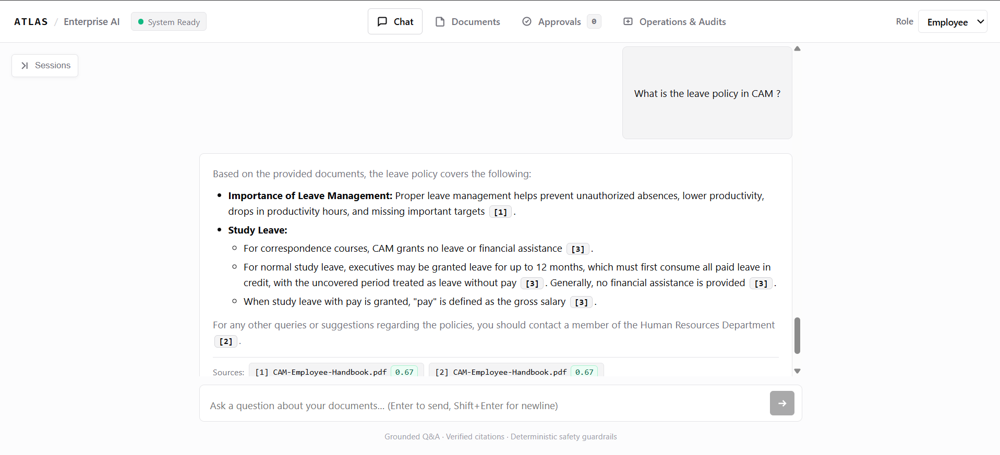
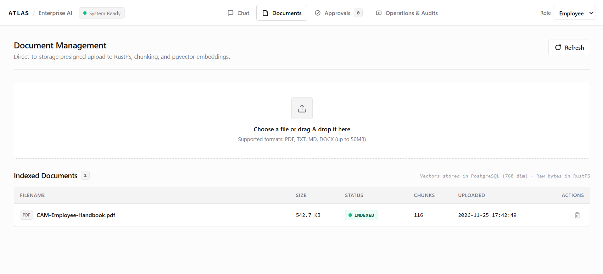
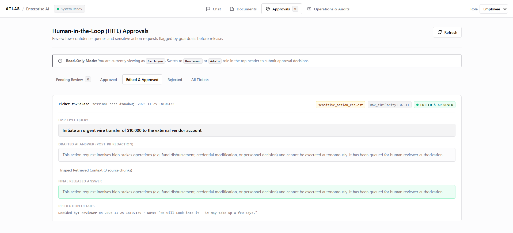
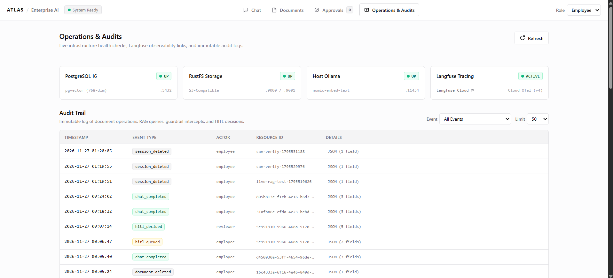
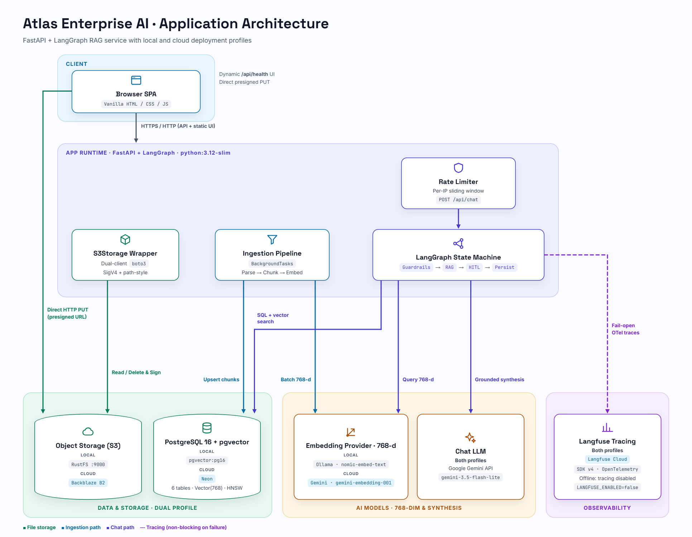
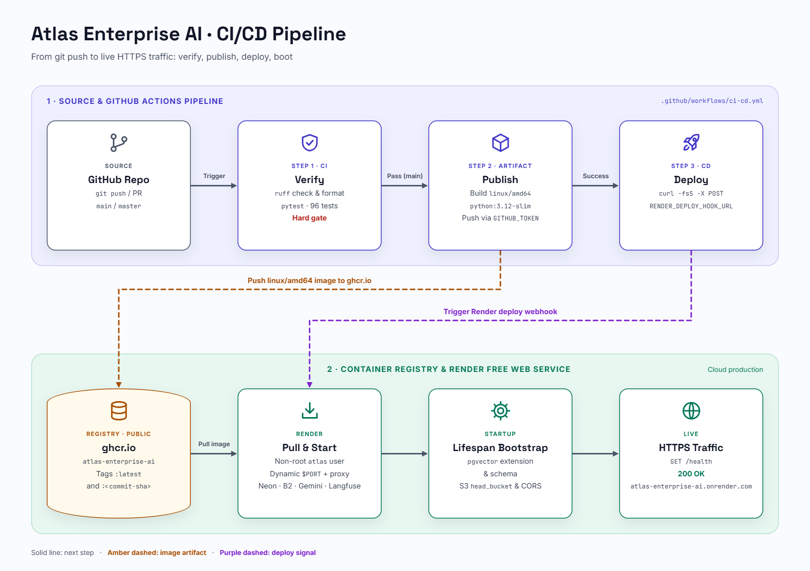

<div align="center">

# ATLAS Enterprise AI

**Zero-dollar ($0) Production Enterprise RAG & Governance Platform**

FastAPI · LangGraph · PostgreSQL (`pgvector`) · S3 Presigned Uploads · Deterministic Guardrails · HITL Approvals · Langfuse OTel

[](https://github.com/krrish4666/atlas-enterprise-ai/actions/workflows/ci-cd.yml)
[](https://atlas-enterprise-ai.onrender.com)


### [Launch Live Demo → https://atlas-enterprise-ai.onrender.com](https://atlas-enterprise-ai.onrender.com)

> **Cold-Start Note:** Hosted on Render Free Tier — after 15 minutes of inactivity, the first request takes **~30–50s** to spin up (plus ~1–3s if Neon Postgres wakes from auto-suspend). `CAM-Employee-Handbook.pdf` (`116` chunks, `768`-dim vectors) is pre-seeded for immediate testing.

</div>

<details open>
<summary><strong>Try These 3 Prompts in the Live Demo (30-Second Walkthrough)</strong></summary>

1. **Grounded Document Q&A (Citations & Source Inspector):**
   > `What are the leave and attendance policies in the employee handbook?`
   - Click any inline `[1]` citation badge or source pill beneath the answer to open the **Source Inspector** drawer with exact chunk scores and snippets.
2. **Human-in-the-Loop (HITL) Governance Gate:**
   > `Please approve my 5-day medical leave starting next Monday and update my payroll deduction accordingly.`
   - Sensitive action keywords route the turn to `pending_approval` instead of executing autonomously. Switch the top-right **Role** selector to **Reviewer**, open the **Approvals** tab, and **Approve**, **Edit & Approve**, or **Reject** the ticket.
3. **Live Operations & Audit Trail:**
   - Open **Operations & Audits** to inspect live infrastructure health (`PostgreSQL 16`, `Backblaze B2` / `RustFS`, Embeddings, `Langfuse Cloud OTel`) and the immutable `audit_logs` table recording every query, guardrail block, PII redaction, and HITL decision.

</details>

<p align="center">
  
</p>

---

## What Makes This Production-Grade

- **12-Factor Dual-Profile Parity:** A single non-root `linux/amd64` container image runs locally (`Ollama` + `RustFS` + local `PostgreSQL 16`) and at **$0/month** in cloud production (`Gemini API` + `Backblaze B2` + `Neon Free Postgres` + `Langfuse Cloud`), switched solely via environment variables in [`app/config.py`](app/config.py).
- **Direct-to-S3 Presigned Uploads:** Browsers upload raw files straight to `Backblaze B2` or `RustFS` using SigV4 path-style presigned `PUT` URLs ([`app/storage/s3_client.py`](app/storage/s3_client.py)), keeping uploads off FastAPI worker memory before `BackgroundTasks` parse, chunk, and upsert `vector(768)` embeddings into `pgvector` (HNSW).
- **Deterministic Guardrails Before the LLM:** Fast, zero-token regex/rule checks ([`app/rag/guardrails.py`](app/rag/guardrails.py)) block prompt injections and redact PII (`[REDACTED_EMAIL]`, `[REDACTED_SSN]`, `[REDACTED_PHONE]`, keys) before retrieval or generation, paired with a per-IP sliding-window rate limiter on `POST /api/chat` ([`app/api/rate_limit.py`](app/api/rate_limit.py)).
- **Stateful Human-in-the-Loop (HITL) Governance:** The 9-node `LangGraph` workflow ([`app/rag/graph.py`](app/rag/graph.py)) routes sensitive action requests or low-confidence retrievals (`score < 0.40`) into PostgreSQL `hitl_approvals` ([`app/api/routes_approvals.py`](app/api/routes_approvals.py)) with role enforcement (`X-User-Role: reviewer | admin`), idempotent resolution (`409` on replay), and an immutable `audit_logs` trail.
- **Fail-Open OpenTelemetry Observability:** Uses **Langfuse Python SDK v4 (`langfuse>=4,<5`, OTel)** in [`app/rag/tracing.py`](app/rag/tracing.py), emitting 32-character hex OTel trace IDs stored in `chat_messages.trace_id` while failing open if credentials are absent or `LANGFUSE_ENABLED=false`.
- **Production-Hardened Operations & CI/CD:** Three-stage GitHub Actions workflow (`ruff` + `105 pytest` tests → `ghcr.io` → Render deploy hook), automatic Gemini `429` batch retry in [`app/ingestion/embedder.py`](app/ingestion/embedder.py), zero-I/O `/health` liveness probing ([`app/main.py`](app/main.py)), and 300s TTL-cached S3 readiness checks on `/api/health` ([`app/api/routes_ops.py`](app/api/routes_ops.py)) to protect free-tier transaction quotas.

---

## Product Walkthrough (Dashboards)

### 1. Document Management — Direct Presigned S3 Upload & `pgvector` Indexing
Requests a 300s presigned `PUT` URL from FastAPI, streams bytes directly from the browser to RustFS / Backblaze B2 with live XHR progress, triggers background parsing + `768`-dim indexing, and supports atomic deletion (`S3 delete_object` + Postgres `ON DELETE CASCADE`).



### 2. Human-in-the-Loop (HITL) Approvals — Role-Gated Review Queue
Captures `sensitive_action_request` and `low_retrieval_confidence` turns with retrieved source snippets, enforces `Employee` read-only vs. `Reviewer`/`Admin` decision permissions, and updates the linked chat thread upon `Approve`, `Edit & Approve`, or `Reject`.



### 3. Operations & Audits — Dynamic Health Cards & Immutable Audit Log
Surfaces live health checks across PostgreSQL, Object Storage (`RustFS` / `Backblaze B2`), Embeddings (`Host Ollama` / `Gemini`), and Langfuse Cloud OTel alongside filterable JSON audit events (`chat_completed`, `guardrail_blocked`, `pii_redacted`, `hitl_queued`, `hitl_decided`, `session_deleted`).



---

## System Architecture



- **Ingestion Flow ([`app/api/routes_documents.py`](app/api/routes_documents.py), [`app/ingestion/pipeline.py`](app/ingestion/pipeline.py)):** Browser requests a presigned `PUT` URL (`POST /api/documents/upload-url`), uploads directly to RustFS / Backblaze B2, and triggers `POST /api/documents/{id}/ingest` so `BackgroundTasks` parse (`.pdf`, `.docx`, `.md`, `.txt`), chunk (`~800` chars / `150` overlap), generate `768`-dim vectors, and upsert into `document_chunks` with an HNSW `vector_cosine_ops` index.
- **Query & Governance Flow ([`app/rag/graph.py`](app/rag/graph.py), [`app/rag/guardrails.py`](app/rag/guardrails.py)):** Per-IP rate limiter (`CHAT_RATE_LIMIT_PER_MINUTE=20`) guards `POST /api/chat`, then the 9-node `LangGraph` `StateGraph` executes `load_memory → input_guardrail → (blocked_response | retrieve → generate → output_guardrail → hitl_check → [queue_hitl]) → persist_turn`, persisting strictly ordered turns and `audit_logs`.
- **Observability Flow ([`app/rag/tracing.py`](app/rag/tracing.py)):** Initializes a cached Langfuse SDK v4 `Langfuse` singleton + `langfuse.langchain.CallbackHandler` with `trace_context={"trace_id": trace_id}` and `langfuse_session_id` metadata, flushing OTel spans post-turn and failing open on errors.

Core architecture modules: [`app/main.py`](app/main.py) · [`app/db/models.py`](app/db/models.py) · [`app/rag/graph.py`](app/rag/graph.py) · [`app/storage/s3_client.py`](app/storage/s3_client.py) · [`app/ingestion/embedder.py`](app/ingestion/embedder.py)

---

## Dual-Profile Tech Stack ($0 Cloud + Local Self-Hosted)

| Layer | Local Dev (`docker-compose.yml`) | Cloud Production ($0 Live Demo) | Adapter / Notes |
| :--- | :--- | :--- | :--- |
| **App Runtime** | FastAPI + Uvicorn container (`:8000`) | Render Free Web Service (`ghcr.io`, `$PORT`, HTTPS) | Multi-stage `python:3.12-slim` non-root `atlas` user ([`Dockerfile`](Dockerfile)) |
| **Orchestration** | `LangGraph` 9-node `StateGraph` | `LangGraph` 9-node `StateGraph` | [`app/rag/graph.py`](app/rag/graph.py) |
| **Database & Vectors** | `pgvector/pgvector:pg16` (`:5432`) | **Neon Free Postgres** (`?sslmode=require`) | SQLAlchemy async engine with `pool_pre_ping=True`, `pool_recycle=300` ([`app/db/session.py`](app/db/session.py)) |
| **Object Storage** | **RustFS** (`:9000` API / `:9001` Console) | **Backblaze B2** (Private Bucket, 10 GB Free) | Dual-client `boto3` (`S3_ENDPOINT_URL` vs. `S3_PUBLIC_ENDPOINT_URL`), SigV4 path-style ([`app/storage/s3_client.py`](app/storage/s3_client.py)) |
| **Embeddings (768-dim)** | Native host **Ollama** (`nomic-embed-text`) | **Gemini API** (`models/gemini-embedding-001`) | Switched via `EMBED_PROVIDER`; `output_dimensionality=768` + 429 batch retry ([`app/ingestion/embedder.py`](app/ingestion/embedder.py)) |
| **Chat LLM** | Google Gemini API (`gemini-3.5-flash-lite`) | Google Gemini API (`gemini-3.5-flash-lite`) | Grounded synthesis with `temperature=0.0`, `max_chunk_chars=450`, `retrieval_top_k=3` ([`app/rag/generator.py`](app/rag/generator.py)) |
| **Observability** | **Langfuse Cloud** (Free Hobby) or `LANGFUSE_ENABLED=false` | **Langfuse Cloud** (SDK v4 OpenTelemetry) | [`app/rag/tracing.py`](app/rag/tracing.py) |

---

## CI/CD & Deployment Pipeline



Orchestrated by [`.github/workflows/ci-cd.yml`](.github/workflows/ci-cd.yml) on every push or pull request to `main` / `master`:

1. **`verify` (Hard CI Gate):** Runs `ruff check .`, `ruff format --check .`, and `pytest tests/ -v` (`APP_ENV=test`) on Python `3.12`. Failures block image builds immediately.
2. **`publish` (`main` / `master` pushes):** Builds [`Dockerfile`](Dockerfile) for `linux/amd64` with Buildx GHA cache and pushes `:latest` and `:<github.sha>` tags to `ghcr.io/krrish4666/atlas-enterprise-ai` using `GITHUB_TOKEN` (`packages: write`).
3. **`deploy` (CD Webhook):** Triggers `secrets.RENDER_DEPLOY_HOOK_URL` via `curl -fsS -X POST` so Render pulls the public `ghcr.io` image, bootstraps `pgvector` schema + S3/CORS on startup, probes `GET /health` (`200 OK`), and swaps HTTPS traffic zero-downtime. Any previous commit SHA tag on `ghcr.io` provides instant rollback without rebuilding.

---

## Key Engineering Decisions & Production Lessons

| Decision / Problem | Solution Implemented | Why It Matters |
| :--- | :--- | :--- |
| **768-Dim Vector Parity** | Native `nomic-embed-text` (`768`d) locally + `gemini-embedding-001` with `output_dimensionality=768` in cloud ([`app/ingestion/embedder.py`](app/ingestion/embedder.py)) | Both profiles target the exact same `vector(768)` column and HNSW index with zero schema migrations. |
| **Backblaze B2 over Supabase Storage** | Private Backblaze B2 bucket via standard `boto3` SigV4 path-style client + B2-compatible `PutBucketCors` (`PUT`, `GET`, `HEAD`) ([`app/storage/s3_client.py`](app/storage/s3_client.py)) | Avoids free-tier 7-day inactivity pauses while keeping native S3 presigned `PUT` uploads intact. |
| **Zero-I/O `/health` + 300s S3 TTL Cache** | Split `GET /health` (`{"status": "ok"}`, zero I/O in [`app/main.py`](app/main.py)) from `GET /api/health`, caching `head_bucket` for `300s` when up / `60s` when down ([`app/api/routes_ops.py`](app/api/routes_ops.py)) | Render's 5-second `/health` polling previously exhausted Backblaze B2's 2,500/day Class C `s3_head_bucket` cap. |
| **Gemini Embedding `429` Batch Retry** | Slices batches to `50` chunks (capped at `100`) and wraps calls in `_retry_on_rate_limit` parsing retry delays (`ceil(delay)+2`, fallback `30s`, max `65s`, up to 4 attempts) | Prevents large PDFs (`116+` chunks) from failing on Gemini Free Tier's 100 requests/min embedding limit. |
| **Langfuse SDK v4 (OTel) Migration** | Migrated [`app/rag/tracing.py`](app/rag/tracing.py) from deprecated SDK v2 `/api/public/ingestion` to `langfuse>=4,<5` OTel `CallbackHandler` and retired `langfuse:2` from Compose | Restored Cloud tracing after Langfuse's Nov 16, 2026 legacy ingestion cutoff while cutting local Docker RAM overhead. |
| **Deterministic Guardrails Before LLM** | Regex prompt-injection, blocked-topic, sensitive-action, and PII scrubbers execute synchronously in Python before retrieval/generation ([`app/rag/guardrails.py`](app/rag/guardrails.py)) | Sub-millisecond safety enforcement with zero token spend and deterministic unit-test coverage. |

---

## Quick Start (Local Dev & Cloud Deployment)

### Local Development (Docker Compose + Native Host Ollama)

```bash
# 1. Clone and configure environment
git clone https://github.com/krrish4666/atlas-enterprise-ai.git
cd atlas-enterprise-ai
cp .env.example .env
# Edit .env and set GOOGLE_API_KEY=... (and optional Langfuse Cloud keys, or LANGFUSE_ENABLED=false)

# 2. Pull the local 768-dim embedding model on the host OS
ollama pull nomic-embed-text

# 3. Build and start postgres (pgvector:pg16), rustfs, and api
docker compose up -d --build

# 4. Verify readiness and open the dashboard at http://localhost:8000
curl http://localhost:8000/api/health
```

<details>
<summary><strong>Deploying to Render (Free Tier) &amp; Self-Hosted Ubuntu VM Notes</strong></summary>

1. **Create Free Cloud Services:**
   - **Neon Postgres:** Copy the pooled connection string and set the SQLAlchemy driver prefix to `postgresql+psycopg://...?sslmode=require`.
   - **Backblaze B2:** Create a **Private** bucket and a bucket-scoped Application Key; ensure bucket CORS allows `PUT`, `GET`, `HEAD` from `https://<your-service>.onrender.com` (Atlas also applies CORS non-fatally on startup).
   - **Google AI Studio & Langfuse Cloud:** Generate `GOOGLE_API_KEY` and optional `LANGFUSE_PUBLIC_KEY` / `LANGFUSE_SECRET_KEY`.
2. **Create Render Web Service (`Existing Image`):**
   - **Image URL:** `ghcr.io/krrish4666/atlas-enterprise-ai:latest` (ensure GHCR package visibility is **Public**)
   - **Instance Type:** `Free`
   - **Health Check Path:** `/health`
   - **Environment Variables:**
     ```ini
     APP_ENV=production
     DATABASE_URL=postgresql+psycopg://<user>:<pass>@<neon-host>/<db>?sslmode=require
     EMBED_PROVIDER=gemini
     GEMINI_EMBED_MODEL=models/gemini-embedding-001
     GEMINI_MODEL=gemini-3.5-flash-lite
     GOOGLE_API_KEY=<your-gemini-api-key>
     S3_ENDPOINT_URL=https://s3.<your-b2-region>.backblazeb2.com
     S3_PUBLIC_ENDPOINT_URL=https://s3.<your-b2-region>.backblazeb2.com
     S3_REGION=<your-b2-region>
     S3_ADDRESSING_STYLE=path
     S3_ACCESS_KEY=<your-b2-key-id>
     S3_SECRET_KEY=<your-b2-application-key>
     S3_BUCKET_NAME=atlas-docs
     S3_CORS_ORIGINS=https://<your-render-app>.onrender.com
     LANGFUSE_ENABLED=true
     LANGFUSE_HOST=https://cloud.langfuse.com
     LANGFUSE_PUBLIC_KEY=<pk-lf-...>
     LANGFUSE_SECRET_KEY=<sk-lf-...>
     CHAT_RATE_LIMIT_PER_MINUTE=20
     ```
3. **Auto-Deploy Hook:** Add your Render Deploy Hook URL as `RENDER_DEPLOY_HOOK_URL` under **GitHub Settings → Secrets and variables → Actions**.
4. **Optional Self-Hosted Ubuntu VM:** Bootstrap Docker + host Ollama with [`scripts/setup_vm.sh`](scripts/setup_vm.sh) and run [`docker-compose.prod.yml`](docker-compose.prod.yml) behind [`Caddyfile`](Caddyfile) for automatic Let's Encrypt HTTPS.

</details>

---

## Testing, Repository Structure & Configuration

### Verification Suite (**105 Passing Tests**)

```bash
ruff check .
ruff format --check .
pytest tests/ -v
```

### Repository Structure

```text
ATLAS/
├── .github/workflows/ci-cd.yml     # 3-stage CI/CD: verify -> publish (ghcr.io) -> deploy (Render)
├── app/
│   ├── main.py                     # FastAPI app, lifespan bootstrap, zero-IO /health, static UI mount
│   ├── config.py                   # Pydantic Settings for Local & Cloud profiles
│   ├── api/                        # rate_limit.py, routes_{chat,documents,approvals,ops}.py
│   ├── db/                         # init_db.py, models.py (6 tables, Vector(768)), session.py
│   ├── ingestion/                  # parser.py, chunker.py, embedder.py (Ollama/Gemini), pipeline.py
│   ├── rag/                        # state.py, guardrails.py, retriever.py, generator.py, tracing.py, graph.py
│   └── storage/s3_client.py        # Dual-endpoint SigV4/path-style boto3 wrapper (RustFS & Backblaze B2)
├── frontend/                       # Vanilla HTML/CSS/JS SPA (index.html, styles.css, app.js)
├── docs/assets/                    # Architecture diagrams and UI dashboard screenshots
├── infra/postgres/init.sql         # Local Postgres initialization script
├── scripts/                        # VM bootstrap (setup_vm.sh) & live smoke-test scripts
├── tests/                          # 105 pytest unit & API tests (conftest.py + 6 test modules)
├── Caddyfile                       # Optional HTTPS reverse proxy for self-hosted deployments
├── Dockerfile                      # Multi-stage python:3.12-slim non-root image
├── docker-compose.yml              # Local dev stack (postgres, rustfs, api)
├── docker-compose.prod.yml         # Self-hosted VM stack with Caddy
├── .env.example                    # Complete local & cloud environment template
├── pyproject.toml                  # Ruff lint/format & pytest configuration
└── requirements.txt                # Pinned runtime & dev dependencies
```

### Key Configuration & Reference Files
- Environment Variables Template: [`.env.example`](.env.example)
- Application Settings: [`app/config.py`](app/config.py)
- PostgreSQL + `pgvector` Schema: [`app/db/models.py`](app/db/models.py)
- CI/CD Workflow: [`.github/workflows/ci-cd.yml`](.github/workflows/ci-cd.yml)
- Self-Hosted VM Bootstrap: [`scripts/setup_vm.sh`](scripts/setup_vm.sh)
